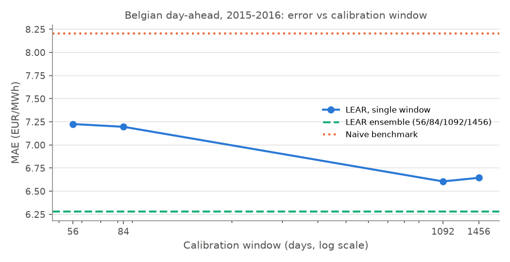
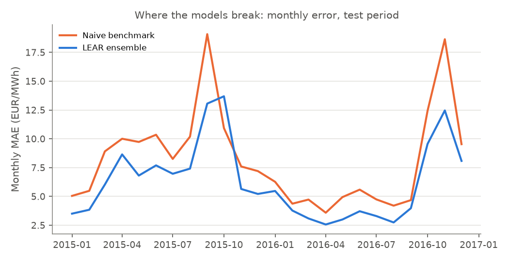
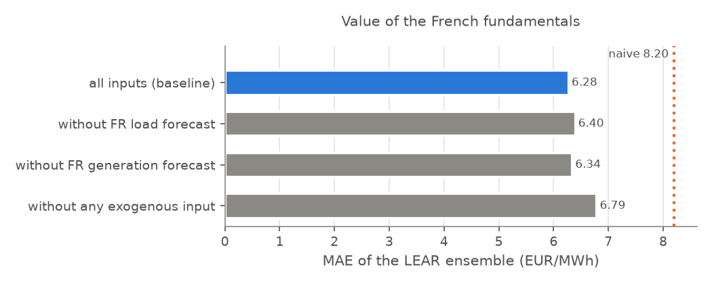

# Belgian day-ahead power price forecasting — how much does LEAR buy over a naive forecast?

[](https://github.com/julienmoury/be-power-price-forecasting/actions/workflows/ci.yml)

## Question

On the Belgian day-ahead market, **by how many EUR/MWh does the LEAR model (the
open-access benchmark of Lago et al., 2021) reduce the forecast error of a naive
"same hour yesterday / last week" forecast**, and is it worth running four calibration
windows instead of the best single one? Where does the model break, and how much does
it depend on the French fundamentals it is fed?

All numbers below are produced by `scripts/make_report.py` from the forecasts in
`results/forecasts/` (full tables: [`results/summary.md`](results/summary.md),
[`results/metrics.json`](results/metrics.json)).

## Data

- **Belgian benchmark dataset of Lago et al. (2021)**, Zenodo record
  [4624805](https://zenodo.org/records/4624805), file `BE.csv`, versioned in `data/raw/`:
  hourly day-ahead prices in Belgium (EUR/MWh), 2011-01-09 to 2016-12-31 (52,416 hours,
  no gaps). The two exogenous inputs are the **day-ahead load and generation forecasts
  for France** (mean load ≈ 54 GW, i.e. French, not Belgian, magnitudes), reflecting the
  strong BE–FR market coupling.
  **Licence on Zenodo: "Other (Open)"** (no named licence; see Limitations).
  CI reads this full file: it is the benchmark itself, open and small (1.9 MB), and the
  long-window reproduction test (1,456 calibration days) needs it. All other tests use
  small fixtures.
- **Test period**: 2015-01-04 to 2016-12-31 (728 days), the period of the paper.
- Data access is behind a `PriceSource` interface
  ([`data/sources.py`](src/be_power_forecast/data/sources.py)); an ENTSO-E source (phase B,
  2019–2026, needs `ENTSOE_API_KEY`) plugs in without touching the model; its data are
  downloaded to a git-ignored local cache and never committed (see Limitations).

## Method

- **LEAR** (LASSO-Estimated AutoRegressive): one LASSO regression per delivery hour on
  the 24 prices of days d-1, d-2, d-3, d-7, the exogenous forecasts of days d, d-1, d-7
  and day-of-week dummies (247 inputs); asinh-median variance-stabilising transform;
  penalty chosen by AIC along the LARS path; **recalibrated every day** on a rolling
  window of 56, 84, 1092 or 1456 days. The **ensemble** is the mean of the four windows.
- **Naive benchmark**: Monday/Saturday/Sunday copy the same day one week before,
  Tuesday–Friday copy the previous day.
- **Metrics**: MAE, RMSE, sMAPE, rMAE; **Diebold-Mariano** test on daily-averaged loss
  differentials (multivariate DM, one-sided).
- Code adapted (not imported) from `jeslago/epftoolbox` (Apache-2.0), see
  [THIRD_PARTY_NOTICES.md](THIRD_PARTY_NOTICES.md).

### Validation of the adapted code

The original epftoolbox LEAR no longer runs as-is on scikit-learn ≥ 1.2 (`LassoLarsIC`
changed and now refuses fewer samples than features, which is the case for the 56-day
window). The penalty selection of the original was re-implemented on top of `lars_path`.
Tests (`tests/test_reference.py`) check the port against the **original code run under
scikit-learn 0.23.2 / Python 3.8**:

- LEAR forecasts: identical up to 5·10⁻⁹ EUR/MWh (4 windows × 6 dates across the test period);
- MAE, sMAPE, rMAE (three naive variants) and DM p-values: identical to machine precision.

**Reproduction of the published results.** The epftoolbox library code does *not*
reproduce, day by day, the LEAR forecasts published with the paper (unchanged since
2020), neither with the current exogenous lags (d-1, d-7) nor with the pre-June-2024
ones (d-1, d-2). At aggregate level:

| Model | MAE (this repo) | MAE (published) |
|---|---|---|
| LEAR 56 | 7.23 | 6.92 |
| LEAR 84 | 7.20 | 6.80 |
| LEAR 1092 | 6.61 | 6.59 |
| LEAR 1456 | 6.65 | 6.63 |
| LEAR ensemble | 6.28 | 6.14 |

Long windows match within 0.02 EUR/MWh; the short windows are 0.3–0.4 EUR/MWh worse,
which makes the ensemble 0.14 EUR/MWh worse than published.

## Results

| Model (728 test days) | MAE (EUR/MWh) | RMSE | sMAPE % | rMAE |
|---|---|---|---|---|
| Naive | 8.20 | 18.69 | 19.65 | 1.00 |
| LEAR 56 | 7.23 | 16.83 | 16.89 | 0.88 |
| LEAR 84 | 7.20 | 16.71 | 17.01 | 0.87 |
| LEAR 1092 | 6.61 | 16.47 | 16.92 | 0.80 |
| LEAR 1456 | 6.65 | 16.42 | 17.36 | 0.81 |
| **LEAR ensemble** | **6.28** | **16.04** | **14.97** | **0.76** |

- **LEAR ensemble vs naive: −1.92 EUR/MWh (−23.5 %)**, DM p = 1.3·10⁻¹³. Summed over a
  year on a 1 MW baseload profile, this is about 16,800 EUR of absolute price error
  avoided (an error measure, not a trading P&L).
- **Ensemble vs best paper window (1092 days): −0.33 EUR/MWh (−5.0 %)**, DM p = 1.3·10⁻⁶.
- Short windows (56, 84) are not significantly different from each other (DM p = 0.36);
  long windows (1092, 1456) neither (p = 0.09).



## Robustness — where the model breaks

**Calibration window.** The single-window error falls from 7.42 (28 days) to a minimum of
6.53 at 728 days, then rises slightly (6.61 at 1092, 6.65 at 1456). No single window,
including 728 days which is not in the paper's set, beats the 4-window ensemble (6.28).

**Sub-periods** (ensemble vs naive):

| Period | Days | Mean price | MAE naive | MAE ensemble | Gain | DM p |
|---|---|---|---|---|---|---|
| 2015 | 362 | 44.70 | 9.44 | 7.42 | 21.4 % | < 0.001 |
| Jan–Sep 2016 (low prices) | 274 | 29.40 | 4.79 | 3.51 | 26.7 % | < 0.001 |
| Q4 2016 (French nuclear inspections) | 92 | 58.10 | 13.48 | 10.01 | 25.8 % | 0.001 |
| Spike days (daily max > 95 EUR/MWh, top 5 %) | 37 | 84.74 | 31.05 | 27.30 | 12.1 % | **0.18** |
| Other days | 691 | 38.27 | 6.98 | 5.15 | 26.2 % | < 0.001 |
| Weekday peak 08–20h | 520 | 50.37 | 10.41 | 8.12 | 22.1 % | < 0.001 |
| Weekday off-peak | 520 | 37.63 | 6.64 | 5.07 | 23.6 % | < 0.001 |

- **Spike days are where LEAR breaks**: the gain shrinks to 12 % and is not significant
  (p = 0.18); errors are ~5× larger than on normal days.
- **The best window depends on the regime**: in 2015 long windows win (1456 days: 7.24 vs
  56 days: 8.75); in the low-price Jan–Sep 2016 regime short windows win (84 days: 3.78 vs
  1456 days: 4.62). The ensemble is the best specification in 6 of the 8 sub-periods and
  within 0.18 EUR/MWh of the best single window in the other two (2015, spike days).



**Inputs removed** (ensemble of the 4 windows, DM p-value that the baseline is better):

| Inputs | MAE ensemble | Δ vs baseline | DM p |
|---|---|---|---|
| All inputs (baseline) | 6.28 | — | — |
| Without FR load forecast | 6.40 | +0.12 | < 0.001 |
| Without FR generation forecast | 6.34 | +0.07 | 0.004 |
| Without any exogenous input | 6.79 | +0.52 | < 0.001 |

The French fundamentals are worth 0.52 EUR/MWh, and almost all of it comes through the
short windows (56 days: 7.23 → 8.19 without exogenous inputs; 1092 days: 6.61 → 6.68).
Long windows can do without the French generation forecast (1092 days: 6.52 without it
vs 6.61 with it).



## Decision

**Use the 4-window LEAR ensemble, fed with the French load and generation forecasts, as
the Belgian day-ahead baseline**: it cuts the naive error by 23 %, and since the best
single window changes with the price regime, averaging four windows is the cheapest
insurance against picking the wrong one (best in 6 of 8 sub-periods, never more than
0.18 EUR/MWh behind the best window). Do **not** rely on it on spike
days, where it is statistically no better than the naive forecast: anything exposed to
the price tails (peak hedging, battery dispatch) needs a dedicated spike/scarcity model or
a risk overlay on top. Before using it on today's market, re-run the comparison on
2019–2026 data (phase B), since the 2022 crisis and the move to 15-minute day-ahead
products (1 October 2025) are outside this sample.

## Limitations

- Sample ends in 2016: no negative-price regime of the 2020s, no 2022 crisis, no
  15-minute products. Phase B (ENTSO-E) is prepared but not run.
- ENTSO-E re-use terms (official "List of Data available for free re-use", version of
  18/10/2023, Legal Terms and Conditions of the Transparency Platform; checked on
  2026-10-09): only the day-ahead load forecasts (art. 6.1.b) are on the list, under
  CC BY 4.0; the day-ahead prices (12.1.d), generation forecasts (14.1.c) and wind and
  solar forecasts (14.1.d) are not. No raw ENTSO-E data are therefore committed: they stay
  in a git-ignored local cache, CI uses synthetic XML fixtures, and the repository only
  holds our forecasts and aggregated metrics. Reproducing phase B needs your own
  ENTSO-E API token.
- The published LEAR forecasts of the paper are not reproduced day by day by the public
  code (see above); the comparison is at aggregate level.
- The Zenodo record of the benchmark dataset states its licence only as "Other (Open)",
  without naming a licence; re-use terms beyond research use are therefore imprecise.
- Point forecasts only; no probabilistic evaluation.
- MAE-based "EUR per MW-year" is an error measure, not the value of the forecast for a
  given trading strategy.

## Reproduce

```bash
pip install -e ".[dev]"
pytest -q                                  # unit + reproduction tests (~2 min)
python scripts/run_experiments.py          # ~4 h on 4 cores, resumable
python scripts/make_report.py              # results/summary.md, metrics.json, figures
```

## References

- J. Lago, G. Marcjasz, B. De Schutter, R. Weron (2021). *Forecasting day-ahead
  electricity prices: A review of state-of-the-art algorithms, best practices and an
  open-access benchmark.* Applied Energy 293, 116983.
- B. Uniejewski, J. Nowotarski, R. Weron (2016). *Automated variable selection and
  shrinkage for day-ahead electricity price forecasting.* Energies 9(8), 621.
- B. Uniejewski, R. Weron, F. Ziel (2018). *Variance stabilizing transformations for
  electricity spot price forecasting.* IEEE Transactions on Power Systems 33(2).
- F. X. Diebold, R. S. Mariano (1995). *Comparing predictive accuracy.* Journal of
  Business & Economic Statistics 13(3).
- Source code: [jeslago/epftoolbox](https://github.com/jeslago/epftoolbox) (Apache-2.0).
- Data: Zenodo record [4624805](https://zenodo.org/records/4624805).
