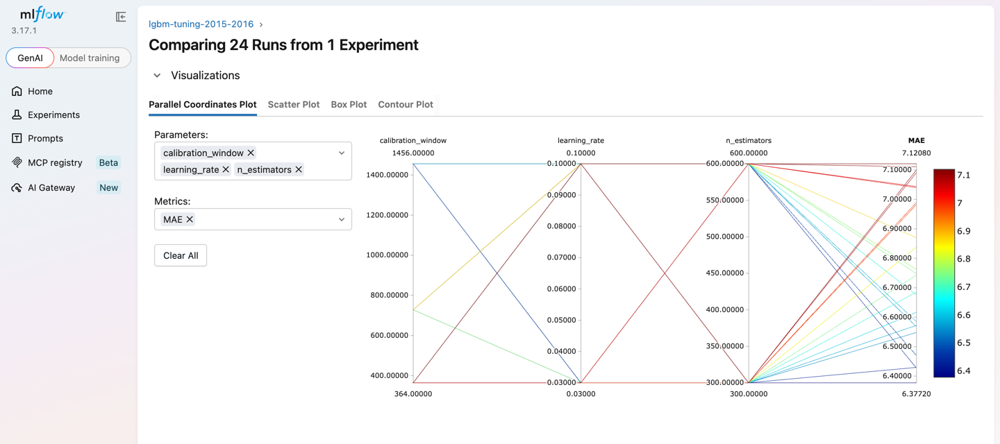

# Forecasting tomorrow's Belgian electricity prices

[](https://github.com/julienmoury/be-power-price-forecasting/actions/workflows/ci.yml)

Every day before noon, an auction sets the Belgian electricity price for each hour of the
next day. Producers, suppliers and battery operators all want to know these prices in
advance. In this project I took the reference benchmark of the field (Lago et al., 2021),
checked that I get the same results as the paper, and then ran it, unchanged, on the ten
years that followed, to see whether it still holds on today's market.

**[Live page](https://dkx1i5wqs8b2p.cloudfront.net/)**: the forecasts of every day since 1 October 2026, against
the realised prices, updated every evening. The forecasts are also served by a public API,
`https://ivqhqjlyjymcnufukn7vjp5mee0yezkr.lambda-url.eu-central-1.on.aws/` (`GET /health`, `POST /forecast`, `GET /forecasts`;
[schema](docs/openapi.json)).

## In short

- **The paper is reproduced.** On its test period (2015–2016), my LEAR ensemble has an
  error of 6.28 EUR/MWh (paper: 6.14) and
  my neural network ensemble 5.85 (paper: 5.87).
- **The models still work today.** From 2017-01-01 to 2026-09-30, the LEAR
  ensemble makes 34 % less error than a naive forecast.
- **The neural network is no longer better.** It was clearly better in 2015–2016; on
  2017–2026 the two models are statistically tied (14.46 vs
  14.52 EUR/MWh).
- **A tuned LightGBM does not beat them.** Beyond the paper, I tuned a gradient-boosting
  challenger on 2015–2016 and tracked the 24 trials
  with MLflow. On 2017–2026 it beats the naive forecast but makes more error than both
  models of the paper (16.41 EUR/MWh).
- **Hourly forecasts have a floor.** Since October 2025 the market sets 96 quarter-hour
  prices a day; even a perfect hourly forecast would miss them by
  7.91 EUR/MWh on average.

## The models

- **Naive forecast**, the baseline any model has to beat: tomorrow looks like today
  (Monday and the weekend copy the same day of last week).
- **LEAR**: one linear regression per hour of the day. The inputs are the prices of the
  last days (d-1, d-2, d-3, d-7), the French load and generation forecasts (Belgium and
  France are coupled through the market) and the day of the week. A LASSO penalty keeps
  only the useful inputs. The model is re-estimated every day on four history lengths
  (56 days to 4 years), and the four forecasts are averaged.
- **DNN**: the paper's four small neural networks, with the settings published by the
  authors, retrained every day and averaged.

To compare two models I use the error in EUR/MWh (MAE) and the Giacomini-White test, which
tells whether one model is really better or just lucky on this sample.

## What I did

1. **Ported the code.** The paper's code no longer runs with recent
   libraries. I rewrote the parts I needed and checked them against the original code:
   same LEAR forecasts to 10⁻⁶ EUR/MWh, same DNN training to 5e-09 EUR/MWh.
2. **Reproduced the paper** on its Belgian dataset (2011–2016).
3. **Extended it to today** with ENTSO-E data, from 2017 to September 2026: the 2022
   crisis, negative prices (2.3 % of hours) and the switch to
   quarter-hours. Nothing was re-tuned.
4. **Made it run on its own.** Since 1 October 2026, the day after the backtest ends, a
   scheduled task on AWS (ECS Fargate) downloads the new data every evening, retrains the
   models, forecasts the next day and updates the live page (S3 and CloudFront). The errors
   since 1 October are computed in SQL (DuckDB). The infrastructure is in Terraform and
   deployed by GitHub Actions ([docs/aws.md](docs/aws.md)). A small API (FastAPI, in Docker,
   on AWS Lambda) serves the forecasts to my
   [storage project](https://github.com/julienmoury/be-storage-dispatch), which computes what
   they are worth to a battery.

## Results

**Paper's test period, 2015-01-04 to 2016-12-31 (728 days)**

| Model | Error (MAE, EUR/MWh) | Paper |
|---|---:|---:|
| Naive | 8.20 | —* |
| LEAR ensemble | 6.28 | 6.14 |
| DNN ensemble | **5.85** | 5.87 |

\* The Paper column is computed from the forecasts the paper publishes (Zenodo), LEAR and
DNN only: no naive forecast is published.

The LEAR beats the naive forecast by 23 %, and the DNN beats the LEAR
(GW p = 2.8e-08), as in the paper.

**Today's market, 2017-01-01 to 2026-09-30 (3523 days)**

| Model | Error (MAE, EUR/MWh) |
|---|---:|
| Naive | 21.87 |
| LEAR ensemble | 14.52 |
| DNN ensemble | 14.46 |
| LightGBM (challenger, beyond the paper) | 16.41 |

Errors are much larger than in 2015–2016 because prices are much more volatile, but both
models still beat the naive forecast by a third. Between the two, the test does not
separate them: for "the DNN is better", GW p = 0.51; for
"the LEAR is better", p = 1.


*Monthly error of each model; the LightGBM challenger (see below) runs on 2017–2026 only.*

Every single model (each history length, each network) is in
[`results/summary.md`](results/summary.md).

## Challenger beyond the paper: LightGBM

To see whether a popular modern model does better, I added a LightGBM challenger, kept
apart from the reproduction. It gets exactly the inputs of the LEAR and, like it, one
model per hour retrained every day on the past only.

**Tuning before the test.** I chose its settings on 2015-01-04 to
2016-12-31 only, before the test period: 24
configurations (history length, tree size, learning rate, number of trees), each backtested
with a weekly retraining and recorded as one MLflow run with its settings, its error and its
duration. The best one (1456 days of history,
15 leaves, learning rate 0.03,
300 trees) had an error of 6.38 EUR/MWh,
against 7.12 for the worst. I froze it, then ran the 2017–2026
test once, with no re-tuning.



*Each line is one configuration, coloured by its error: the longest history and the
slowest learning rate win.*

**Result: it loses.** On 2017–2026 it makes 25 % less
error than the naive forecast, but more than the LEAR ensemble
(16.41 vs 14.52 EUR/MWh) and the DNN
ensemble (14.46). The GW test is clear: for "the LEAR is
better", p < 10⁻¹⁵; for "the DNN is better",
p < 10⁻¹⁵. The gap is widest in the 2022 crisis
(50.94 vs 41.43 EUR/MWh
for the LEAR). A likely reason: a tree can only predict values close to those it saw in
training, so it cannot follow
prices that rise above their past range, while a linear model can. The yearly errors are
in [`results/summary.md`](results/summary.md). LightGBM is also in the live forecast.

## What I take away

- The simple linear model holds up remarkably well: ten years later, on a very different
  market, it is as good as the neural network, at a fraction of the cost.
- The DNN settings were tuned on 2011–2016 data. Re-tuning them on recent data might help
  it, but that would no longer be the paper's model.
- Reproducing a paper is harder than it looks: the public code does not give exactly the
  published LEAR forecasts day by day (the long windows match, the short ones do not), so
  I compare with the paper on overall errors.

## Limits

- **The forecast is made after the auction.** One input of the paper, the French
  generation forecast, is published after the noon deadline. The live forecast follows
  the paper, so it could not have been used to bid.
- **Hourly forecasts on a quarter-hour market** (see above).
- **Only France as a neighbour**, and no weather, gas price or Belgian wind and solar
  forecasts: these are not in the paper.
- ENTSO-E prices are not on its free re-use list, so no raw ENTSO-E data are in this
  repository; reproducing the extension needs your own ENTSO-E token. The live page shows
  realised prices from SMARD.de (CC BY 4.0).

## What I would do next

With the paper's inputs, neither the DNN nor LightGBM beats the linear model, so the next
gain is more likely to come from better inputs than from a more complex model. To turn this
into a forecast usable today, I would:

1. **Forecast before the auction from Belgian fundamentals**: Belgian load, wind and solar
   forecasts, weather and the gas price. Wind and solar push the price down and gas plants
   often set it (the merit order).
2. **Add the other coupled markets** (Netherlands, Germany), whose prices move with the
   Belgian one.
3. **Forecast the 96 quarter-hours directly.**
4. **Check what the model learned** (SHAP values): does it react to wind and gas as the
   merit order says it should?

Each new model would be compared with the LEAR ensemble on the same days, with the same
test.

## How it is organised

```
src/be_power_forecast/
  data/         ENTSO-E download, daylight-saving and quarter-hour handling
  models/       LEAR and DNN (adapted from the paper's code), LightGBM challenger
  evaluation/   error measures, Diebold-Mariano and Giacomini-White tests
  api/          FastAPI service, with the naive forecast as fallback
  live.py       daily forecast
  sql/          live errors in SQL (DuckDB), run by live_report.py
  cloud.py      S3 state of the AWS deployment
scripts/        backtests, LightGBM tuning, report, live forecast (aws_run.py: on AWS)
infra/          AWS infrastructure (Terraform), see docs/aws.md
tests/          unit tests and checks against the original code (run in CI)
```

The numbers of this README are read from [`results/metrics.json`](results/metrics.json)
by `scripts/make_report.py`, so the text cannot drift from the results.

## Reproduce

```bash
pip install -e ".[dev,api]"                 # Python 3.11–3.13
pytest -q                                   # tests, including the checks against the paper's code
export ENTSOE_API_KEY=...                   # your own token
python scripts/build_phase_b.py             # download ENTSO-E data
python scripts/run_experiments.py           # backtests on the paper's period (long)
pip install -e ".[experiments]"             # MLflow, for the LightGBM tuning
python scripts/tune_lgbm.py                 # tuning on 2015–2016, tracked in mlruns/ (long)
python scripts/run_experiments.py --phase B # backtests 2017–2026, LightGBM included (long)
python scripts/make_report.py               # metrics.json, figure, README
```

## Reference

- J. Lago, G. Marcjasz, B. De Schutter, R. Weron (2021). *Forecasting day-ahead
  electricity prices: A review of state-of-the-art algorithms, best practices and an
  open-access benchmark.* Applied Energy 293, 116983.
- Data: Zenodo record [4624805](https://zenodo.org/records/4624805), ENTSO-E Transparency
  Platform, SMARD.de.
