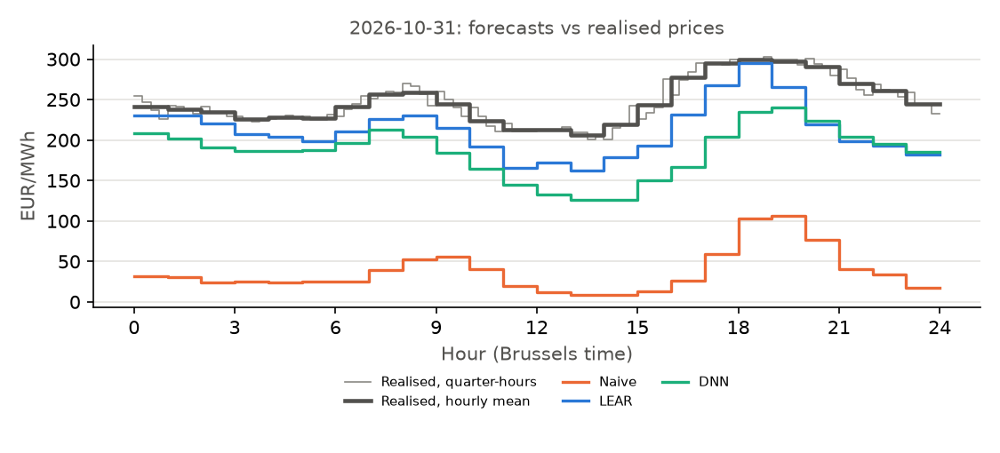

# Live: Belgian day-ahead prices

Since 1 October 2026, the day after the end of the backtest, the two models of the project forecast every Belgian delivery day: the LEAR ensemble and the DNN ensemble, retrained every evening exactly as in the backtest. Each forecast is then compared with the realised prices.

The forecasts use the French generation forecast, which is published after the 12:00 auction: they follow the paper, but could not have been used to bid.

Updated on 2026-10-31.

## Today, 2026-10-31

Error (MAE, EUR/MWh) against the hourly mean of the realised prices:

| Naive | LEAR | DNN | Perfect hourly forecast* |
|---|---|---|---|
| 210.64 | 35.99 | 62.34 | 6.06 |

*Against the quarter-hour prices: the error a perfect hourly forecast still makes, since the models forecast hours.

## Since 1 October 2026 (30 days)

| Model | Error since the start | Last 7 days |
|---|---|---|
| LEAR | 32.89 | 41.50 |
| DNN | 33.64 | 58.52 |
| Naive | 53.05 | 86.04 |

Errors in EUR/MWh (MAE), on the days where the three models have a forecast. The naive forecast copies the same day of last week on Mondays, Saturdays and Sundays, the previous day otherwise.

Day by day

| Day | Naive | LEAR | DNN |
|---|---|---|---|
| 2026-10-31 | 210.64 | 35.99 | 62.34 |
| 2026-10-30 | 34.15 | 16.87 | 22.86 |
| 2026-10-29 | 45.82 | 55.78 | 72.03 |
| 2026-10-28 | 90.20 | 36.29 | 53.20 |
| 2026-10-27 | 71.46 | 42.08 | 54.59 |
| 2026-10-26 | 63.96 | 61.97 | 86.09 |
| 2026-10-25 | 166.69 | – | – |
| 2026-10-24 | 125.89 | 46.39 | 32.45 |
| 2026-10-23 | 51.29 | 40.24 | 25.40 |
| 2026-10-22 | 56.38 | 36.86 | 38.93 |
| 2026-10-21 | 19.81 | 29.61 | 11.03 |
| 2026-10-20 | 13.10 | 18.30 | 10.02 |
| 2026-10-19 | 24.11 | 14.59 | 12.47 |
| 2026-10-18 | 63.55 | 57.22 | 42.36 |
| 2026-10-17 | 111.26 | 20.30 | 16.12 |
| 2026-10-16 | 23.24 | 31.44 | 47.00 |
| 2026-10-15 | 10.45 | 9.76 | 14.99 |
| 2026-10-14 | 25.88 | 15.70 | 23.25 |
| 2026-10-13 | 20.48 | 17.18 | 16.68 |
| 2026-10-12 | 27.60 | 24.92 | 33.83 |
| 2026-10-11 | 44.98 | 37.63 | 37.46 |
| 2026-10-10 | 119.78 | 50.06 | 25.05 |
| 2026-10-09 | 60.29 | 72.72 | 75.88 |
| 2026-10-08 | 53.68 | 26.89 | 20.50 |
| 2026-10-07 | 31.47 | 27.75 | 27.52 |
| 2026-10-06 | 34.61 | 34.32 | 34.51 |
| 2026-10-05 | 33.51 | 22.24 | 20.25 |
| 2026-10-04 | 52.90 | 19.91 | 10.25 |
| 2026-10-03 | 20.34 | 21.02 | 22.07 |
| 2026-10-02 | 12.24 | 21.41 | 22.01 |
| 2026-10-01 | 38.50 | 41.24 | 38.00 |

By hour of the day

| Hour | Naive | LEAR | DNN |
|---|---|---|---|
| 0 | 54.60 | 14.98 | 16.03 |
| 1 | 52.77 | 16.28 | 16.28 |
| 2 | 51.89 | 18.41 | 17.79 |
| 3 | 50.09 | 22.70 | 20.25 |
| 4 | 50.36 | 24.22 | 20.12 |
| 5 | 50.45 | 26.77 | 19.76 |
| 6 | 48.77 | 26.10 | 26.67 |
| 7 | 48.60 | 26.16 | 32.56 |
| 8 | 52.71 | 31.33 | 34.74 |
| 9 | 56.41 | 36.61 | 34.80 |
| 10 | 56.97 | 35.77 | 31.85 |
| 11 | 63.19 | 38.30 | 34.54 |
| 12 | 64.22 | 41.97 | 36.84 |
| 13 | 58.40 | 38.63 | 35.60 |
| 14 | 60.32 | 39.00 | 35.29 |
| 15 | 52.04 | 37.23 | 35.14 |
| 16 | 54.68 | 44.27 | 43.32 |
| 17 | 56.45 | 50.62 | 50.58 |
| 18 | 56.86 | 41.53 | 51.24 |
| 19 | 56.74 | 39.76 | 52.18 |
| 20 | 46.16 | 36.53 | 44.08 |
| 21 | 44.45 | 33.53 | 40.47 |
| 22 | 41.14 | 32.62 | 38.61 |
| 23 | 44.94 | 36.03 | 38.58 |

These tables are computed in SQL (DuckDB): [`src/be_power_forecast/sql/`](../src/be_power_forecast/sql/).

Realised prices: Bundesnetzagentur | SMARD.de, CC BY 4.0 (www.smard.de), equal to the ENTSO-E prices. Official prices: [Elia](https://www.elia.be/en/grid-data/transmission/day-ahead-reference-price) and the [ENTSO-E Transparency Platform](https://transparency.entsoe.eu/).
