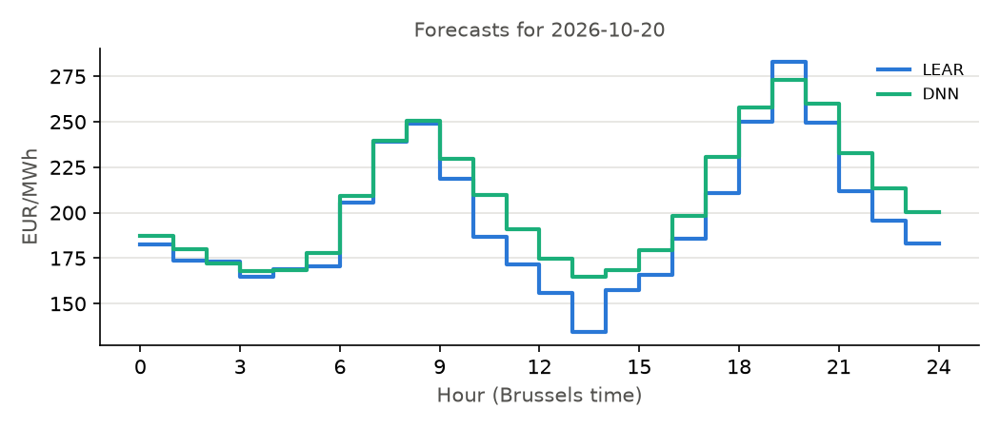

# Live forecast of the Belgian day-ahead price

Updated automatically on 2026-10-19 17:35 (Brussels time) by `scripts/live_forecast.py`, every morning before the 12:00 gate closure of the day-ahead auction. Two models of the backtests, recalibrated every morning and shown side by side (not averaged): the 4-window LEAR ensemble and the ensemble of the four DNNs of Lago et al. (2021).

## Delivery day 2026-10-20

| Hour (EUR/MWh) | 00 | 01 | 02 | 03 | 04 | 05 | 06 | 07 | 08 | 09 | 10 | 11 |
|---|---|---|---|---|---|---|---|---|---|---|---|---|
| LEAR | 182.6 | 173.8 | 173.0 | 164.9 | 169.0 | 170.3 | 205.5 | 239.0 | 249.2 | 218.9 | 186.8 | 171.5 |
| DNN | 187.2 | 179.8 | 172.1 | 167.8 | 168.3 | 177.9 | 209.2 | 239.7 | 250.3 | 229.7 | 209.8 | 190.8 |

| Hour (EUR/MWh) | 12 | 13 | 14 | 15 | 16 | 17 | 18 | 19 | 20 | 21 | 22 | 23 |
|---|---|---|---|---|---|---|---|---|---|---|---|---|
| LEAR | 155.9 | 134.7 | 157.6 | 165.8 | 185.7 | 210.7 | 250.2 | 282.9 | 249.6 | 211.7 | 195.7 | 182.9 |
| DNN | 174.9 | 164.8 | 168.4 | 179.4 | 198.3 | 230.5 | 257.6 | 273.2 | 259.8 | 232.6 | 213.6 | 200.6 |

Hourly prices; since 1 October 2025 each value is the average of four quarter-hours.

The official prices of this day are published after the 12:00 auction, around 13:00, by [Elia](https://www.elia.be/en/grid-data/transmission/day-ahead-reference-price) and the [ENTSO-E Transparency Platform](https://transparency.entsoe.eu/); they are not reproduced here (ENTSO-E re-use terms).
